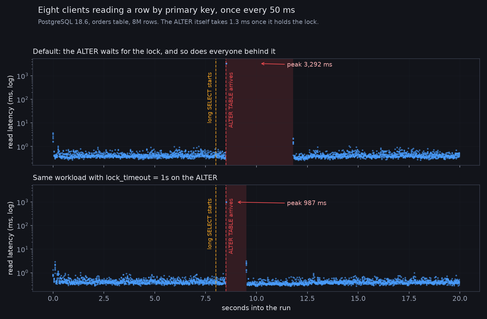

# pg-lock-queue

Postgres grants table locks in arrival order. A statement that cannot get its
lock does not step aside, it waits at the head of the queue, and everything
that arrives after it waits too, including queries that would have been
perfectly compatible with whatever is actually holding the lock.

Measured on PostgreSQL 18.6, `orders` table, 8M rows, 1473 MB.

## The result

Four sessions. `A` runs a 3.8 second read. `C1` and `C2` run the *same*
single-row primary key lookup, 0.7 seconds apart. `B` is an `ALTER TABLE`
that lands between them.

```
arrives t+0.0s  A  long SELECT                waited   3838.8 ms
arrives t+0.3s  C1 reader BEFORE the ALTER    waited      1.2 ms
arrives t+0.5s  B  ALTER TABLE                waited   3340.8 ms
arrives t+1.0s  C2 reader AFTER the ALTER     waited   2841.2 ms
```

The `ALTER TABLE` takes **1.3 ms** once it holds the lock.



## Who is blocked by whom

```
pid=230    None      None         blocked_by=[]        SELECT count(*) FROM orders WHERE md5(payload)
pid=231    Lock      relation     blocked_by=[230]     ALTER TABLE orders ADD COLUMN note text
pid=232    Lock      relation     blocked_by=[231]     SELECT id FROM orders WHERE id=42

pid=230    AccessShareLock        granted=True
pid=231    AccessExclusiveLock    granted=False
pid=232    AccessShareLock        granted=False
```

The reader is blocked by the `ALTER`, not by the long `SELECT`, even though
its lock is compatible with the one actually held.

## The fix

```sql
SET lock_timeout = '1s';
ALTER TABLE orders ADD COLUMN note text;
```

Reader stall drops from a median of 2812 ms to 501 ms, and the `ALTER` fails
loudly with `canceling statement due to lock timeout` instead of quietly
taking the site down.

## Running it

```bash
docker run -d --name pglock -e POSTGRES_PASSWORD=x -e POSTGRES_DB=lab \
  -p 55432:5432 postgres:18
docker exec -i pglock psql -U postgres -d lab < setup.sql
python -m venv .venv && .venv/bin/pip install "psycopg[binary]" matplotlib
.venv/bin/python order.py      # the headline result
.venv/bin/python observe.py    # pg_locks and pg_blocking_pids mid-block
.venv/bin/python cases.py      # lock_timeout, NOWAIT, CONCURRENTLY
.venv/bin/python timeline.py && .venv/bin/python chart.py
```

MIT licensed.
